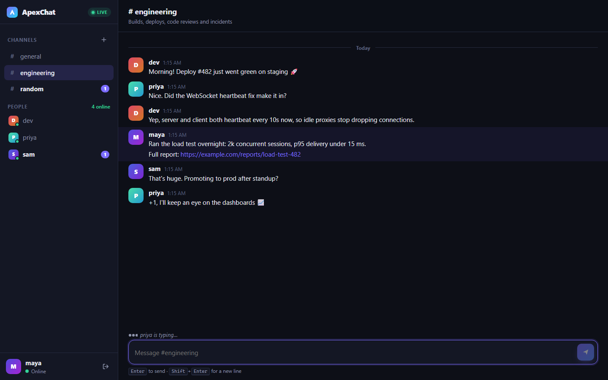
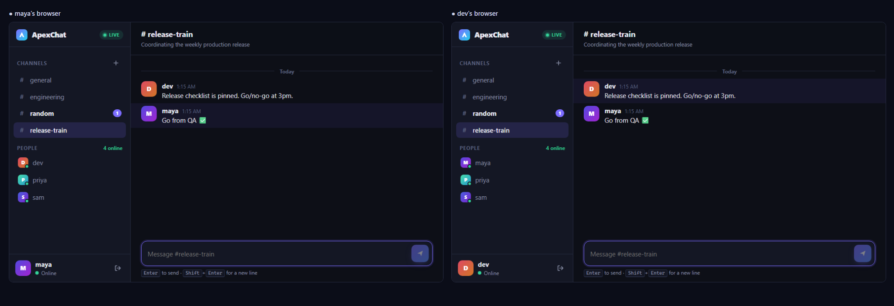
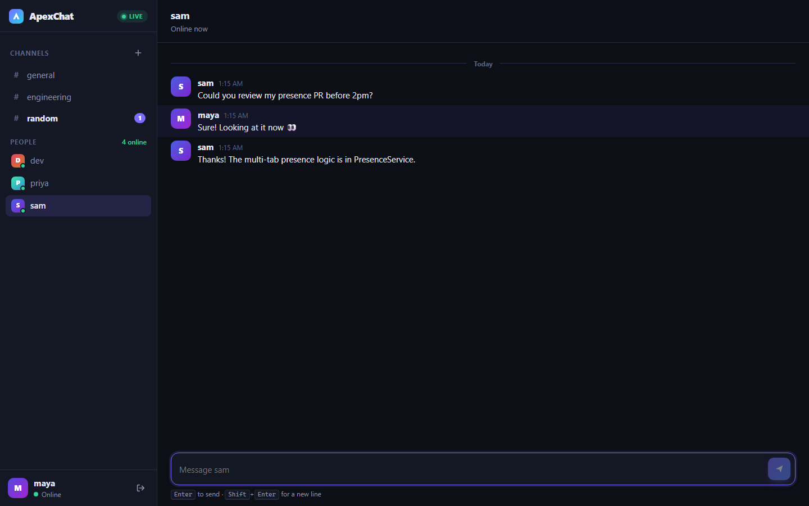
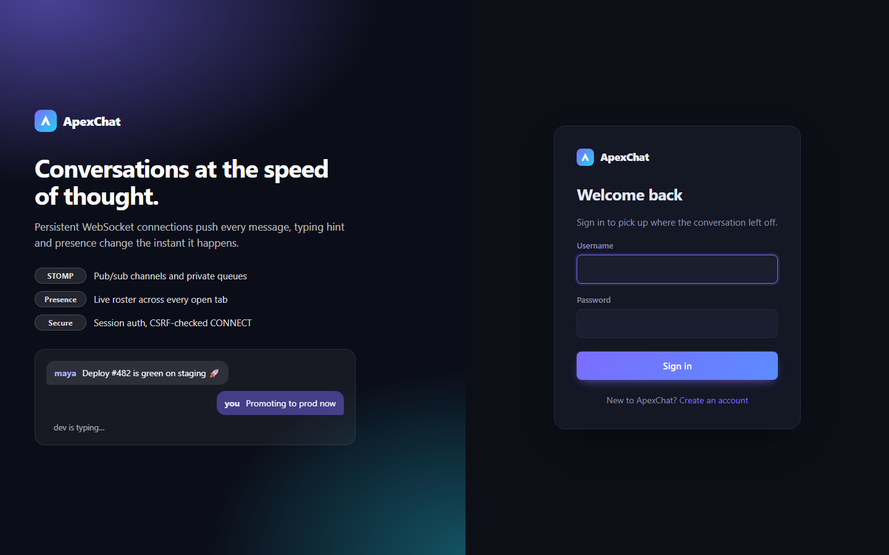
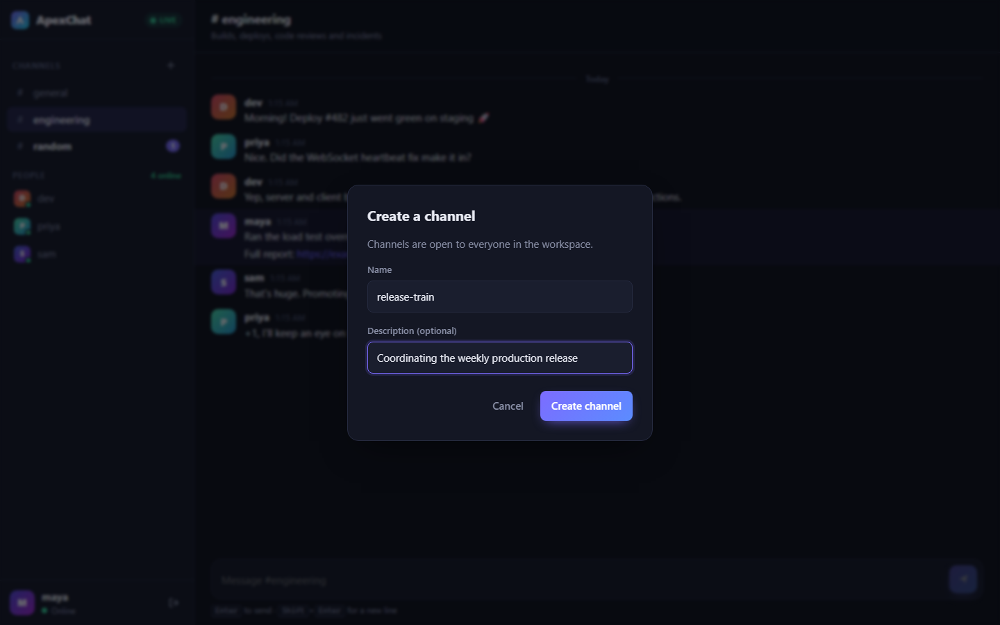
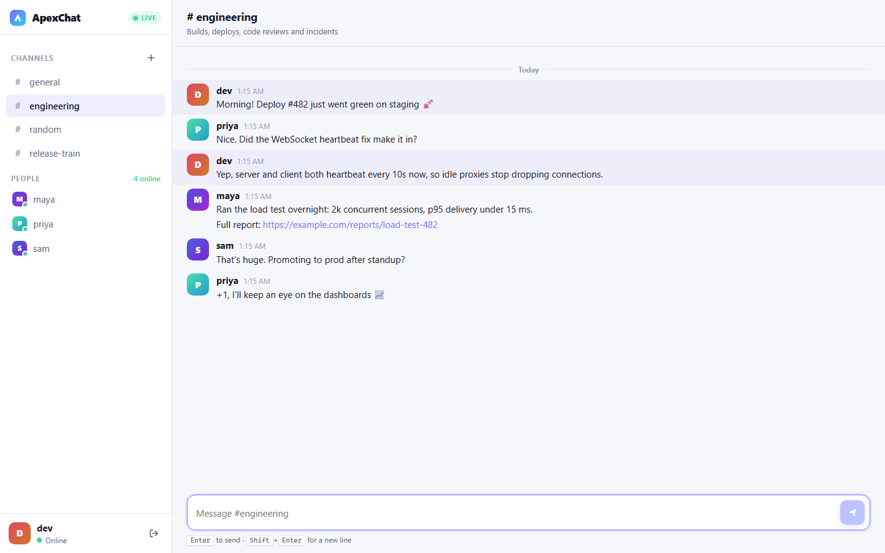
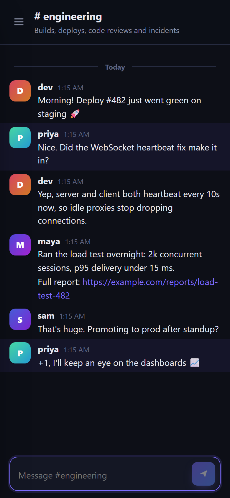
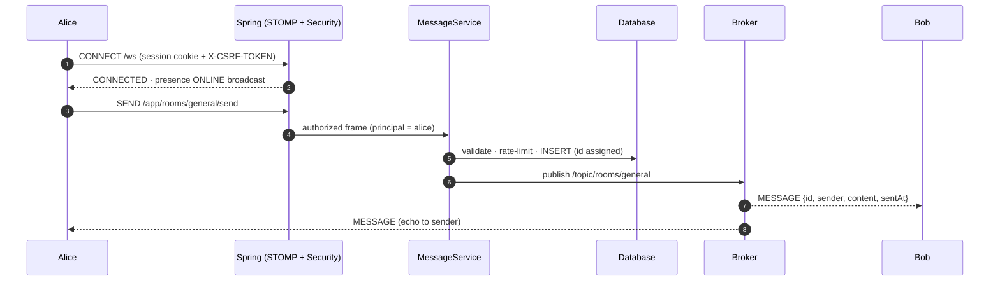

<div align="center">


# ApexChat

**Real-time chat on WebSocket + STOMP, built with Spring Boot.**
Channels, direct messages, live presence across tabs, and typing indicators, all over one
persistent connection.

[](https://github.com/yashwanthdevavarapu/apexchat/actions/workflows/ci.yml)
[](https://github.com/yashwanthdevavarapu/apexchat/actions/workflows/codeql.yml)


[](LICENSE)



</div>

---

## Contents

- [Highlights](#highlights)
- [Screenshots](#screenshots)
- [Quick start](#quick-start)
- [How it works](#how-it-works)
- [Performance](#performance)
- [Testing](#testing)
- [CI/CD](#cicd)
- [Configuration](#configuration)
- [Project layout](#project-layout)
- [Documentation](#documentation)
- [Roadmap](#roadmap)

## Highlights

| | |
|---|---|
| ⚡ **Push, not poll** | One STOMP-over-WebSocket connection per tab carries messages, typing hints, presence and new-channel events. Measured p50 delivery is **48% lower** than even a zero-wait HTTP request/response round trip ([benchmark](docs/benchmark.md)). |
| 📡 **STOMP messaging** | `/topic` fan-out for channels, `/user/queue` routing for DMs (delivered to *every* session of a user), per-sender error queues, 10 s heartbeats both ways, and automatic client reconnect. |
| 🟢 **Accurate presence** | Online status counts live sessions per user, so closing one of three tabs does not mark you offline. A race-safe state machine is covered by a 16-thread concurrency test ([ADR-0006](docs/adr/0006-session-counted-presence.md)). |
| 💬 **Full chat UX** | Channels and DMs, unread badges, typing indicators, message grouping and day dividers, safe auto-linking, deep links (`#room/general`, `#dm/alice`), dark and light themes, mobile layout. |
| 🔐 **Secure by default** | BCrypt form login, **CSRF token required on STOMP CONNECT** (blocks cross-site WebSocket hijacking), a destination allow-list for every frame, strict CSP, per-user rate limiting, XSS-safe rendering ([ADR-0005](docs/adr/0005-websocket-authentication-and-csrf.md)). |
| 🗄️ **Durable history** | Persisted before broadcast. Keyset-paginated history API. Flyway schema that runs on PostgreSQL 16 and H2 ([ADR-0004](docs/adr/0004-persist-then-broadcast.md)). |
| ✅ **Tested at every layer** | 46 unit tests, 30 integration tests (real STOMP client and real WebSocket, plus PostgreSQL via Testcontainers) and 26 Playwright end-to-end tests with multiple simultaneous browsers. **96% line coverage**, with a gate in CI. |
| 📦 **Ship-ready** | Layered Docker image (non-root, healthcheck), `docker compose` stack with PostgreSQL, Prometheus metrics, GitHub Actions for CI, CodeQL, dependency review and tagged releases to GHCR. |

**Tech:** Java 17 · Spring Boot 3.5 (Web, WebSocket, Security, Data JPA, Actuator) · STOMP ·
Thymeleaf · HTML/CSS/JS · PostgreSQL · H2 · Flyway · Micrometer/Prometheus · JUnit 5 ·
Testcontainers · Playwright · Docker · GitHub Actions

## Screenshots

| Real-time in two browsers | Direct messages |
|---|---|
|  |  |
| **Sign in** | **Create a channel** |
|  |  |
| **Light theme** | **Mobile** |
|  |  |

> Every screenshot is generated by [`e2e/screenshots/capture.spec.ts`](e2e/screenshots/capture.spec.ts).
> Four real users chat through the real UI, so the badges, presence dots and typing indicator are
> produced by actual STOMP traffic.

## Quick start

**Prerequisites:** JDK 17+. Docker is optional and needed only for the PostgreSQL stack.

```bash
git clone https://github.com/yashwanthdevavarapu/apexchat.git
cd apexchat
./mvnw spring-boot:run            # Windows: mvnw.cmd spring-boot:run
```

Open <http://localhost:8080>, create an account, then open a **second browser or a private
window**, sign up as someone else, and chat between them.

> The default profile uses in-memory H2, so it needs no setup but data resets on restart.

### With PostgreSQL (production-like)

```bash
docker compose up --build         # app + PostgreSQL 16 → http://localhost:8080
```

### Run the jar

```bash
./mvnw package -DskipTests
java -jar target/apexchat.jar                                  # H2
SPRING_PROFILES_ACTIVE=postgres DB_URL=jdbc:postgresql://localhost:5432/apexchat \
  java -jar target/apexchat.jar                                # PostgreSQL
```

## How it works



| Destination | Direction | Purpose |
|---|---|---|
| `/app/rooms/{slug}/send` · `/app/dm/{user}/send` | client → server | Send a channel or direct message |
| `/app/rooms/{slug}/typing` · `/app/dm/{user}/typing` | client → server | Typing hints (never stored) |
| `/topic/rooms/{slug}` | server → client | Channel messages |
| `/topic/presence` · `/app/presence` | server → client | Presence changes · instant snapshot on subscribe |
| `/user/queue/dm` · `/user/queue/errors` | server → client | Private messages · errors for frames you sent |

Full details: [architecture](docs/architecture.md) · [REST + STOMP API reference](docs/api.md).

## Performance

End-to-end delivery latency (sender submits → another user has the message), with 1,000 samples on
loopback:

| Transport | p50 | p95 |
|---|---:|---:|
| **STOMP over WebSocket (push)** | **9.5 ms** | **13.4 ms** |
| HTTP request/response, best case (POST + immediate GET) | 18.5 ms | 24.2 ms |
| HTTP short polling (1 s) | 519 ms | 968 ms |

Reproduce with `./mvnw test -Pbenchmark`. Method and caveats are in [docs/benchmark.md](docs/benchmark.md).

## Testing

```bash
./mvnw test                     # unit tests (~15 s)
./mvnw verify                   # + integration tests + 80% coverage gate → target/site/jacoco/
./mvnw test -Pbenchmark         # latency benchmark (opt-in)

cd e2e && npm ci && npx playwright install chromium
npm test                        # 26 browser tests; boots target/apexchat.jar automatically
npm run screenshots             # regenerate docs/screenshots/
```

| Layer | What is covered |
|---|---|
| **Unit** | Sliding-window rate limiter, presence state machine (including a concurrent race test), slug generation, message validation and routing, registration rules, error mapping |
| **Integration** | Real login → CSRF → STOMP CONNECT, room fan-out, DM privacy, **DMs reaching every tab of the recipient**, multi-tab presence, typing relay, ERROR frames for denied subscriptions, CONNECT without CSRF rejected, REST pagination, problem details, CSRF on REST, security headers, Prometheus metrics, PostgreSQL migrations |
| **End-to-end** | Two or three simultaneous browsers: live delivery, typing indicator, unread badges, presence on connect, disconnect, multi-tab and sign-out, DM privacy, history after reload, channel creation broadcast, XSS payloads rendered as text, deep links, auth flows |

The integration suite caught a real Spring bug during development: STOMP ordering flags broke
direct messages for users with more than one tab open. The investigation and fix are recorded in
[ADR-0007](docs/adr/0007-message-ordering.md).

## CI/CD

| Workflow | Trigger | What it does |
|---|---|---|
| [`ci.yml`](.github/workflows/ci.yml) | push, PR | Formatting check → `verify` (unit + IT + Testcontainers + coverage gate) → Playwright e2e against the built jar → Docker build and container smoke test. Publishes JUnit, coverage and Playwright reports. |
| [`codeql.yml`](.github/workflows/codeql.yml) | push, PR, weekly | CodeQL security analysis for Java and JavaScript |
| [`dependency-review.yml`](.github/workflows/dependency-review.yml) | PR | Blocks PRs that add dependencies with high-severity CVEs |
| [`release.yml`](.github/workflows/release.yml) | tag `v*.*.*` | Full verify → GitHub Release with the jar → multi-tag image pushed to `ghcr.io` |
| [Dependabot](.github/dependabot.yml) | weekly | Grouped updates for Maven, npm, Actions and Docker |

## Configuration

| Property | Env var | Default | |
|---|---|---|---|
| `server.port` | `PORT` | `8080` | |
| `spring.profiles.active` | `SPRING_PROFILES_ACTIVE` | *(none: H2)* | `postgres` for PostgreSQL |
| `spring.datasource.url` | `DB_URL` | in-memory H2 | used by the `postgres` profile |
| `apexchat.max-message-length` | | `2000` | characters |
| `apexchat.rate-limit.max-messages` / `.window` | | `20` / `10s` | per user, across sessions |
| `apexchat.history-page-size` / `max-history-page-size` | | `50` / `100` | |
| `apexchat.allowed-origins` | | `[]` | extra WebSocket origins (same-origin is always allowed) |

## Project layout

```
.
├── src/main/java/com/apexchat/
│   ├── config/      WebSocket/STOMP broker, HTTP + message security, properties
│   ├── message/     MessageService, STOMP + REST controllers, DTOs
│   ├── presence/    session-counted presence + lifecycle listener
│   ├── room/ user/  channels, accounts, registration
│   └── common/ web/ errors, rate limiter, problem details, pages
├── src/main/resources/
│   ├── db/migration/    Flyway SQL (PostgreSQL + H2)
│   ├── templates/       Thymeleaf: login, register, chat shell
│   └── static/          chat.js (no framework), app.css (dark + light)
├── src/test/java/       unit (*Test), integration (*IT), benchmark
├── e2e/                 Playwright tests + screenshot generator
├── docs/                architecture, API, benchmark, ADRs, screenshots
├── .github/             workflows, issue/PR templates, CODEOWNERS, Dependabot
├── Dockerfile · docker-compose.yml
└── pom.xml · mvnw
```

## Documentation

- [Architecture](docs/architecture.md): components, sequence and state diagrams, destinations
- [API reference](docs/api.md): REST endpoints, STOMP destinations, payloads, error codes
- [Architecture Decision Records](docs/adr/README.md): 10 ADRs, from STOMP vs. raw WebSocket to message ordering
- [Latency benchmark](docs/benchmark.md)
- [Contributing](CONTRIBUTING.md) · [Security policy](SECURITY.md) · [Changelog](CHANGELOG.md)

## Roadmap

- [ ] Horizontal scaling: RabbitMQ STOMP relay, with presence and rate limits in Redis ([ADR-0003](docs/adr/0003-in-memory-simple-broker.md))
- [ ] Read receipts and per-conversation "last read" markers
- [ ] Message edit and delete with tombstones
- [ ] File and image attachments (object storage, signed URLs)
- [ ] Private channels and membership

## License

[MIT](LICENSE)
