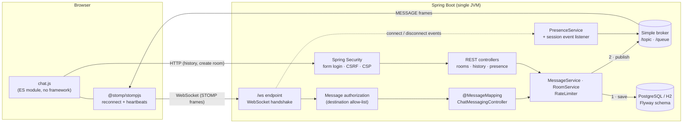
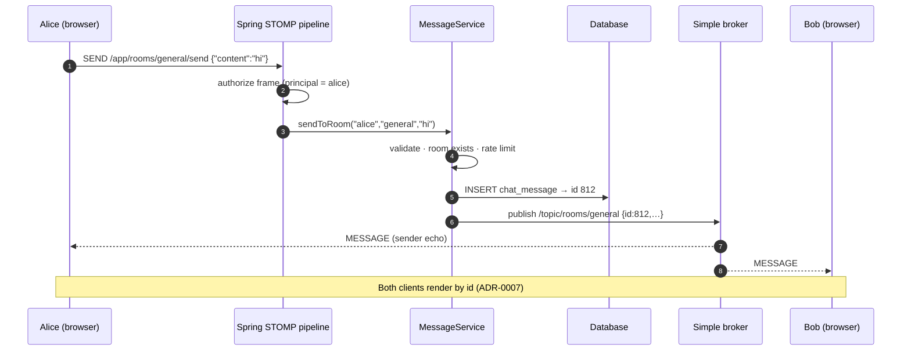
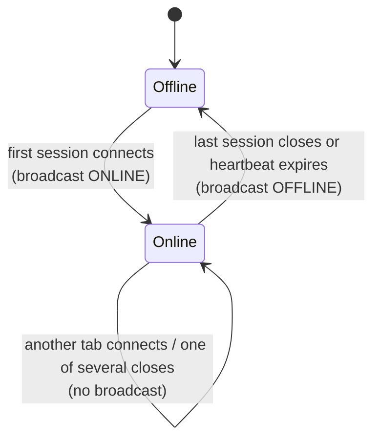

# Architecture

ApexChat is a single Spring Boot service. It serves a server-rendered shell, then switches to one
long-lived **STOMP-over-WebSocket** connection per browser tab. Everything after first paint
(messages, typing hints, presence, new channels) flows over that socket. History comes from a
small REST API.

## Component view



## Sending a channel message



Errors such as a blank message, an unknown room, or sending too fast are thrown as `ChatException`
subclasses. `@MessageExceptionHandler` sends them **only to the sender's session** on
`/user/queue/errors`, and the UI shows them as a toast.

## Presence across tabs



## Destinations

| Direction | Destination | Purpose |
|---|---|---|
| client → server | `/app/rooms/{slug}/send` | Post to a channel |
| client → server | `/app/rooms/{slug}/typing` | Typing hint in a channel |
| client → server | `/app/dm/{user}/send` | Send a direct message |
| client → server | `/app/dm/{user}/typing` | Typing hint in a DM |
| subscribe (reply) | `/app/presence` | One-off roster snapshot |
| server → client | `/topic/rooms` | A channel was created |
| server → client | `/topic/rooms/{slug}` | Channel messages |
| server → client | `/topic/rooms/{slug}/typing` | Channel typing hints |
| server → client | `/topic/presence` | ONLINE / OFFLINE + full roster |
| server → client | `/user/queue/dm` | DMs to *and from* me (all my sessions) |
| server → client | `/user/queue/typing` | DM typing hints |
| server → client | `/user/queue/errors` | Errors for frames I sent |

## Package layout

```
com.apexchat
├── config/     WebSocket + broker, HTTP security, STOMP authorization, properties, clock
├── common/     ChatException hierarchy, ErrorEvent, RateLimiter
├── user/       AppUser, registration, UserDetailsService, login/register pages
├── room/       ChatRoom, slugs, create/list, REST
├── message/    ChatMessage, MessageService, STOMP + REST controllers, DTOs
├── presence/   PresenceService, session event listener, snapshot endpoints
└── web/        Chat page, RFC 9457 problem responses
```

## Observability

- `GET /actuator/health/{liveness,readiness}`: public, used by the Docker `HEALTHCHECK` and CI
  smoke test.
- `GET /actuator/prometheus`: requires authentication. Custom meters:
  - `apexchat_messages_sent_total{channel="room|direct"}`
  - `apexchat_presence_online_users`
  - `apexchat_presence_sessions`
  - plus Spring's built-in WebSocket session stats.

Decision records for everything above live in [`docs/adr/`](adr/README.md).
